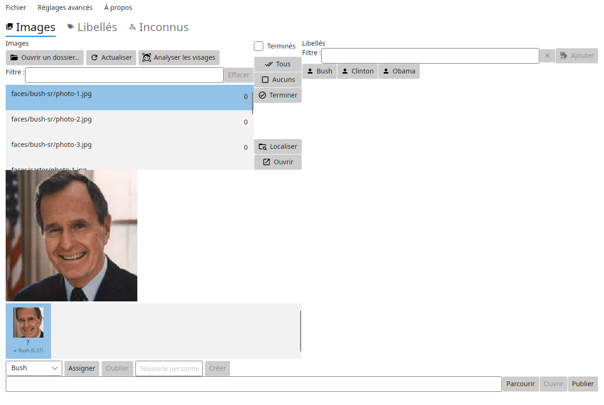

# ImgTagFanOut

 ImgTagFanOut is a versatile image tagging and organization tool designed to simplify the process of categorizing and distributing your image collection as file folders. With ImgTagFanOut, you can effortlessly tag your images and automatically organize them into subdirectories based on these tags. This makes it easy to share specific sets of images with individuals or groups, ensuring everyone gets the pictures that matter most to them.

## Features

- **Effortless Image Tagging**: Simply select a directory containing your images and assign to each of them tag labels to them, making it easy to categorize your collection.

- **Automatic Tag-Based Organization**: ImgTagFanOut automatically creates subdirectories for each tag, ensuring your images are neatly organized for easy access.

- **Customizable Output Directory**: Choose a destination directory where the organized images will be copied, allowing you to keep your original collection intact.

- **Shareable Collections**: Easily share specific image sets with individuals or groups by sending them the corresponding subdirectory containing images matching their interests or needs.

- **Face Tagging**: Detect faces in your photos, name them once and let the application suggest that person on the other photos. Everything runs locally, no image ever leaves the machine.

## How It Works

1. **Select a Directory**: Choose the directory containing your images that you want to organize.

2. **Tag Your Images**: Assign tag labels to your images based on the criteria that matter to you. For example, tag images with the names of people who appear in them.

3. **Automatic Organization**: ImgTagFanOut will create subdirectories for each tag and copy the tagged images into the appropriate subdirectories.

4. **Share with Ease**: Share the subdirectories with friends, family, or colleagues, ensuring they receive the images relevant to them.

ImgTagFanOut simplifies image management, making it a breeze to sort, organize, and distribute your image collection. Try it today and take control of your images like never before!

## Face tagging

Open a folder and run **Analyze faces** (toolbar or *File* menu). Detection and
embeddings run on the CPU, once per photo: results are stored in the workspace
database and only recomputed when a file changes, when the models change, or
when you name a face.

- **Name a face** in the strip under the preview, or type a new person's name.
  Naming a face also tags its photo, so publishing keeps working with tags.
- **Suggestions**: unnamed faces are compared with the ones you already named
  and the closest person is proposed with its score. Selecting the face
  pre-fills the person, so accepting is one click.
- **Unknown faces** tab: unnamed faces are grouped by similarity ("12 people,
  47 photos"). Name a group once and every face in it is linked and every photo
  tagged.
- Removing a person label from a photo also forgets the faces of that photo, so
  what the recogniser learns always matches what the photo claims.

The two models (YuNet for detection, SFace for embeddings, ~39 MB) ship with the
application under `Assets/Models`. They are MIT / Apache-2.0 licensed. Face
detection is not available on macOS yet: OpenCvSharp does not publish macOS
native binaries for OpenCV 5, and the feature disables itself there.

A small demo library (17 public-domain portraits, 6 people) is in `demo/faces`
if you want to try the feature without opening your own photos. See
`demo/faces/README.md` for its limits.

## Supported Image Formats

ImgTagFanOut supports the following image formats: 
-.jpeg
-.jpg 
-.png 
-.gif
-.webp
-.bmp
-.heic

These formats are supported for preview while tagging.

## Supported language

The application has been translated in the following languages:
- French
- English

## Supported Operating system

Thanks to dotnet and [Avalonia](https://www.avaloniaui.net/) this application is running on :
- Windows, the installer available at https://nightly.link/manuc66/ImgTagFanOut/workflows/build/main/artifact.zip
- Linux

MacOs should work as well but has never been tested.

## License

ImgTagFanOut is licensed under the [LGPL-3.0 license](LICENSE), allowing you to use, modify, and distribute the software freely.

---

ImgTagFanOut empowers you to efficiently manage your image collection by tagging, organizing, and sharing with ease. Give it a try and enjoy a hassle-free way to manage your images! If you find this tool useful, consider starring the project to show your support.

